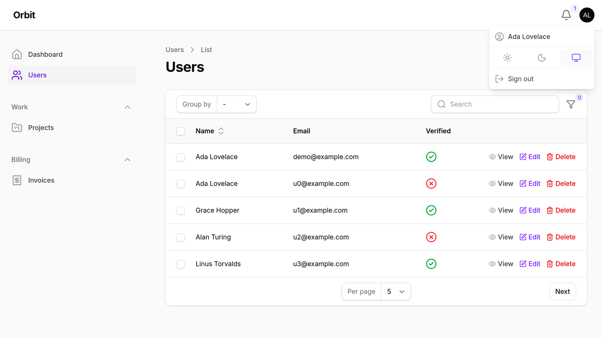

<p class="filament-hidden" align="center">
    
</p>

# Filament Lucide Icons

A [Lucide](https://lucide.dev) icon set for [Filament Icons](https://github.com/filafly/filament-icons). Register one plugin and every icon in Filament's own UI (sidebar, tables, forms, actions, notifications, the rich editor toolbar, multi-factor auth and the rest) switches to Lucide. All 2,287 Lucide icons are also available as an enum for your own resources.

Works with Filament 4 and 5.

More about this package on FilaFly: [Lucide icons for Filament on FilaFly](https://filafly.com/plugins/lucide-icons).

## Coming from codewithdennis/filament-lucide-icons?

That package gives you a Lucide enum to use by hand. This one also swaps every icon in Filament's own UI. The two can't be installed side by side (both register Blade's `lucide` prefix), but the enums use the same case names (all but three, listed below), so switching takes two steps:

```bash
composer remove codewithdennis/filament-lucide-icons && composer require filafly/filament-lucide-icons
```

Then replace `use CodeWithDennis\FilamentLucideIcons\Enums\LucideIcon;` with `use Filafly\Icons\Lucide\Enums\Lucide as LucideIcon;` and register `LucideIcons::make()` as shown below. Your existing `LucideIcon::Bell` calls keep working.

Three cases were renamed upstream in Lucide and only exist under their new names here:

| codewithdennis | filafly |
| --- | --- |
| `BetweenHorizonalEnd` | `BetweenHorizontalEnd` |
| `BetweenHorizonalStart` | `BetweenHorizontalStart` |
| `LocationEdit` | `MapPinPen` |

## Installation

You can install the package via composer:

```bash
composer require filafly/filament-lucide-icons
```

After the package is installed, you must register the plugin in your Filament Panel provider:

```php
use Filafly\Icons\Lucide\LucideIcons;

public function panel(Panel $panel): Panel
{
    return $panel
        ->plugin(LucideIcons::make());
}
```

That's it. Every Filament icon alias (all 223 in Filament 5) is mapped to a Lucide icon.

## Icon style

Lucide has a single outline style, so there are no style methods (`solid()`, `overrideStyleForAlias()` and so on) on this pack. Use the overrides below to pick different icons instead.

## Specifying exact icons to use

You can specify exactly which icon you would like to use in given situations. This can be done via icon aliases or icon enum cases.

### Override icon aliases

Use `overrideAlias()` to change which icon is used for specific Filament icon aliases:

```php
use Filafly\Icons\Lucide\LucideIcons;
use Filafly\Icons\Lucide\Enums\Lucide;
use Filament\View\PanelsIconAlias;
use Filament\Tables\View\TablesIconAlias;

LucideIcons::make()
    ->overrideAlias(PanelsIconAlias::SIDEBAR_EXPAND_BUTTON, Lucide::PanelLeftOpen)
    ->overrideAlias(TablesIconAlias::ACTIONS_FILTER, Lucide::ListFilter);
```

Or use `overrideAliases()` to override multiple aliases at once by passing an array:

```php
LucideIcons::make()
    ->overrideAliases([
        PanelsIconAlias::SIDEBAR_EXPAND_BUTTON => Lucide::PanelLeftOpen,
        TablesIconAlias::ACTIONS_FILTER => Lucide::ListFilter,
    ]);
```

### Override individual icons

Use `overrideIcon()` to replace a Lucide icon everywhere this pack uses it:

```php
LucideIcons::make()
    ->overrideIcon(Lucide::Trash2, Lucide::Trash)
    ->overrideIcon(Lucide::SquarePen, Lucide::Pencil);
```

Or use `overrideIcons()` to override multiple icons at once by passing an array:

```php
LucideIcons::make()
    ->overrideIcons([
        Lucide::Trash2->value => Lucide::Trash,
        Lucide::SquarePen->value => Lucide::Pencil,
    ]);
```
> PHP arrays do not support enums as keys so `->value` is necessary if you want to reference the enum

## Icon enum

All Lucide icons are available through an enum providing convenient usage throughout Filament. For more information, check the [Filament docs](https://filamentphp.com/docs/styling/icons).

```php
use Filament\Forms\Components\Toggle;
use Filafly\Icons\Lucide\Enums\Lucide;

Toggle::make('is_starred')
    ->onIcon(Lucide::Star)
```

The icons come from [mallardduck/blade-lucide-icons](https://github.com/mallardduck/blade-lucide-icons), so `<x-lucide-star />` and `@svg('lucide-star')` work in your own Blade views too.

## Testing

```bash
composer test
```

The suite checks that every icon alias in the installed Filament version is mapped, and that every enum case has an SVG in blade-lucide-icons.

## From FilaFly

FilaFly also makes premium themes for Filament panels: Lucent, Prizm, Cypher and Citrus. [Browse the themes](https://filafly.com/themes?utm_source=github&utm_medium=readme&utm_campaign=lucide-icons).

## License

The MIT License (MIT). Please see [License](LICENSE.md) for more information.

The Lucide icons are © Lucide Icons and Contributors under the ISC License, with some icons derived from Feather (© Cole Bemis, MIT). See [LICENSE-LUCIDE.md](LICENSE-LUCIDE.md).
